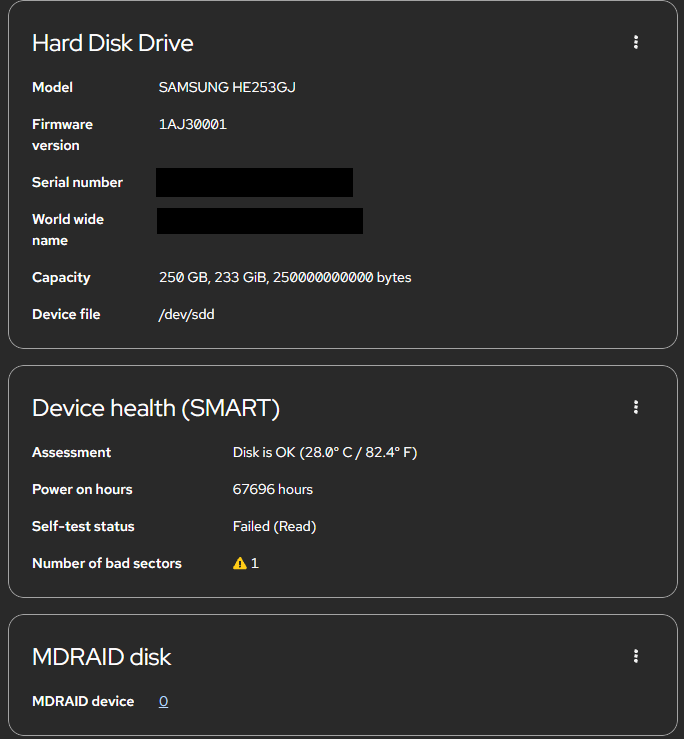

# Backup And Recovery — screenshot evidence

These are selected historical captures, cropped for readability and masked where necessary. They are not new tests.

*Historical SMART failed read self-test and one bad sector on /dev/sdd; reason for recovery planning.*

[Back to technical documentation](../README.md).
