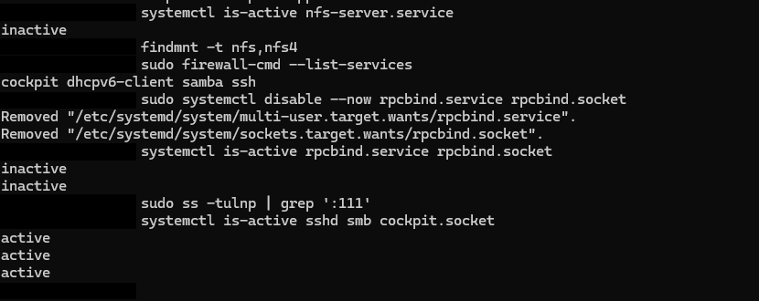

# Linux Administration — screenshot evidence

These are selected historical captures, cropped for readability and masked where necessary. They are not new tests.

*Historical successful SSH key login and refused password-only login; local account names and client key path masked.*

*Historical removal of unused RPC service/socket, inactive status and active SSH, SMB and Cockpit socket verification.*

[Back to technical documentation](../README.md).
