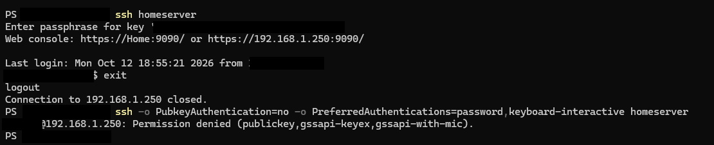

# Linux Administration — screenshot evidence

I captured this evidence during my original configuration and testing. I cropped the images for readability and masked identifiers where necessary.

*I verified successful SSH key login and rejection of password-only login. Local account names and the client key path are masked.*

*I disabled unused RPC units and verified their inactive status alongside active SSH, SMB and Cockpit socket services.*

[Back to technical documentation](../README.md).
