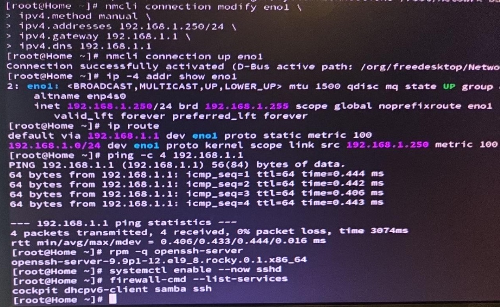

# Networking — screenshot evidence

These are selected historical captures, cropped for readability and masked where necessary. They are not new tests.

*Historical manual IPv4 configuration, route inspection, four successful gateway replies and allowed services. Private RFC1918 LAN addresses are retained.*

[Back to technical documentation](../README.md).
