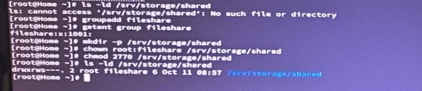
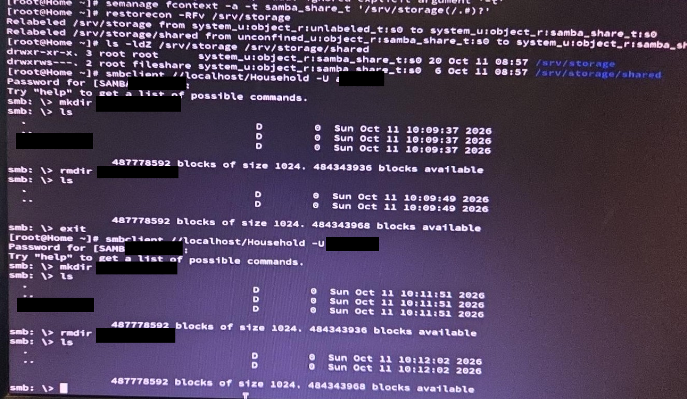

# Samba File Sharing — screenshot evidence

I captured this evidence during my original configuration and testing. I cropped the images for readability and masked identifiers where necessary.

*I inspected the `fileshare` group, `root:fileshare` ownership and setgid `2770` permissions on the shared directory.*

*I corrected the SELinux context and tested directory creation, listing and removal using both SMB accounts before reinstall. Identities are masked.*

[Back to technical documentation](../README.md).
