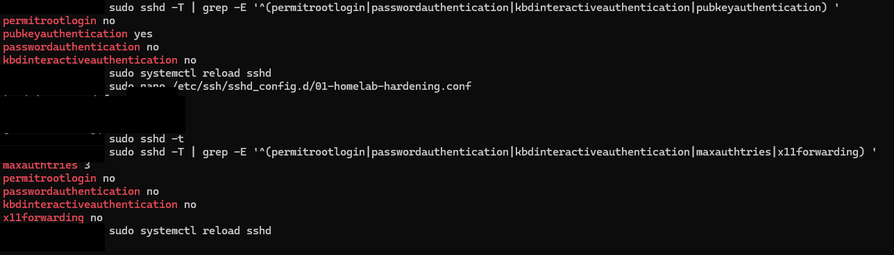

# Security — screenshot evidence

These are selected historical captures, cropped for readability and masked where necessary. They are not new tests.

*Historical sshd -T output showing three authentication attempts, root and password login disabled, keyboard-interactive and X11 forwarding disabled; public key authentication shown enabled in earlier output.*

[Back to technical documentation](../README.md).
