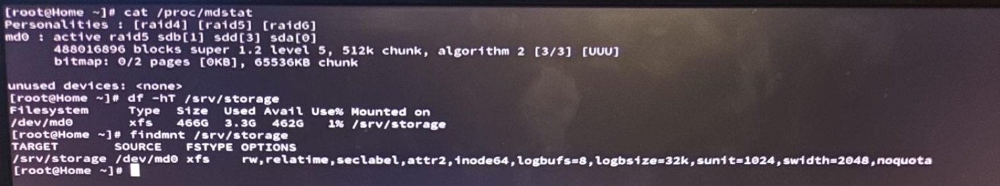

# Storage and RAID — screenshot evidence

I captured this evidence during my original configuration and testing. I cropped the images for readability and masked identifiers where necessary.

*I verified `[3/3] [UUU]`, XFS and the mounted `/srv/storage` filesystem in the original configuration. My later reboot check is documented in the recovery log.*

[Back to technical documentation](../README.md).
