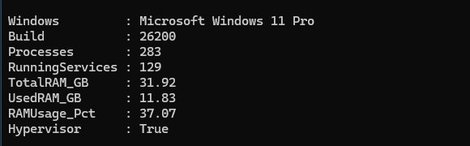
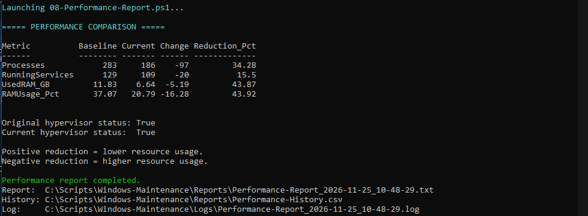

# Windows endpoint optimization — screenshot evidence

These are the two original console-capture images embedded in my November 25, 2026 Windows endpoint optimization report. I extracted the embedded PNGs **without altering their pixels**. The source document had already cropped each capture to the relevant console output; these images are not uncropped desktop screenshots.

## Figure W1 — Initial system baseline

My initial snapshot recorded **283 processes**, **129 running services**, **11.83 GB used RAM** (37.07% of 31.92 GB usable), and an **active Hyper-V hypervisor** on Windows 11 Pro build 26200.

[Open original embedded image](initial-system-baseline-2026-11-25.png)

## Figure W2 — Final performance comparison

The final `08-Performance-Report.ps1` output compares the recorded baseline with **186 processes**, **109 running services**, and **6.64 GB used RAM**. This is **97 fewer processes**, **20 fewer services**, and **5.19 GB less reported RAM use**. The hypervisor remained detected. The captured command output includes local `C:\Scripts\Windows-Maintenance\` report paths, not personal account or credential information.

[Open original embedded image](final-performance-comparison-2026-11-25.png)

## Interpretation and limits

These are genuine before-and-after **resource measurements**, not controlled workload benchmarks. My initial snapshot included Chrome; process counts and memory use can also vary with reboot and workload state. I am not claiming that these captures prove an FPS improvement, faster game loading, VM throughput, or successful unattended Task Scheduler execution. The detailed reports, baseline JSON, and configuration backups stay local.

[Read my Windows optimization case study](../README.md) · [Evidence and provenance](../EVIDENCE.md) · [PowerShell source code](../scripts/README.md)
